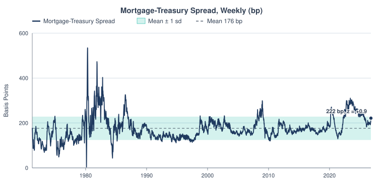
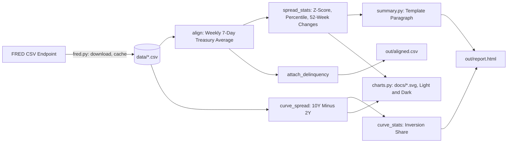
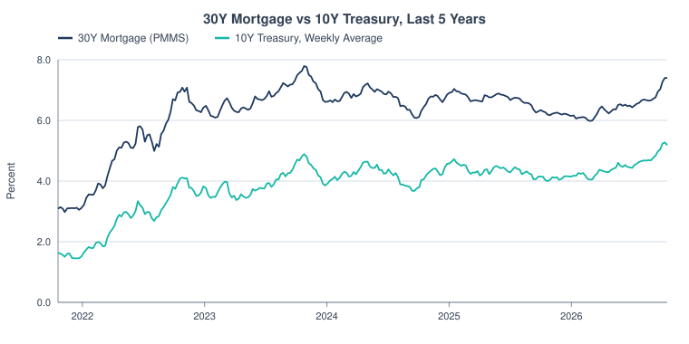
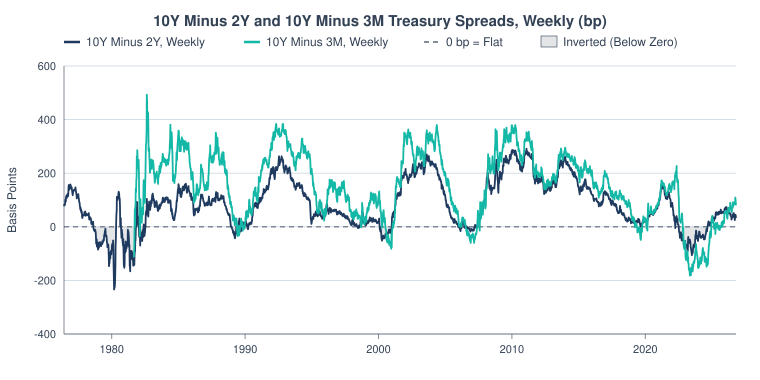
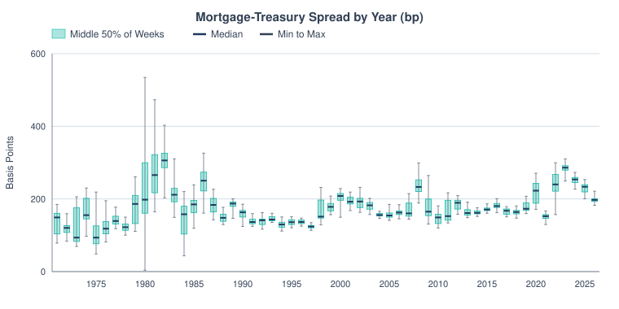
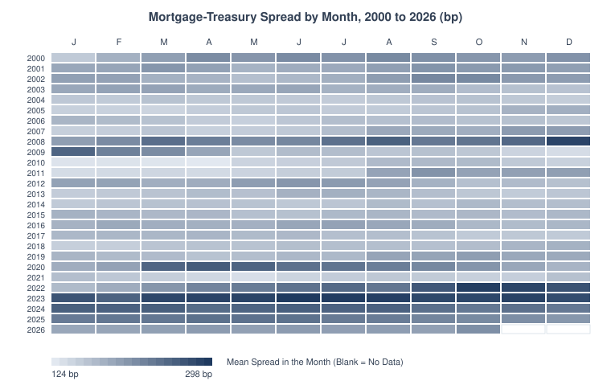
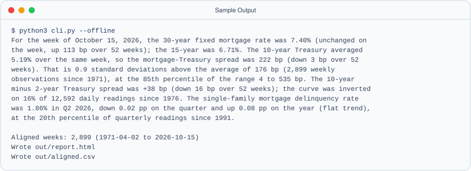

<p align="center">
  <picture>
    <source media="(prefers-color-scheme: dark)" srcset="docs/banner-dark.svg">
    
  </picture>
</p>

  

A small, dependency-free Python tool that pulls public FRED series, aligns weekly
mortgage rates to the same week's 10-year Treasury yield, measures the
mortgage-Treasury spread and the 10Y-2Y and 10Y-3M curve slopes against their own history, and
writes a self-contained HTML report, a CSV of the aligned data, and a short
auto-written market summary. Standard library only (Python 3.9+). No API key and no
`pip install`.

**Why it matters for a rates or mortgage desk.** The mortgage-Treasury spread is the markup borrowers pay over the 10-year,
so where it sits against history says whether mortgages and MBS look cheap or rich and how much of a Treasury move reaches borrowers.

## At a Glance

<picture>
  <source media="(prefers-color-scheme: dark)" srcset="docs/spread-dark.svg">
  
</picture>

*Mortgage-Treasury spread, weekly since 1971. The shaded band is the mean plus or minus one standard deviation; the dot is the latest week.*

## Contents

- [Results at a Glance](#results-at-a-glance)
- [How It Works](#how-it-works)
- [Quickstart](#quickstart)
- [Charts](#charts)
- [Sample Output](#sample-output)
- [Morning Note](#morning-note)
- [Methodology](#methodology)
- [Optional: Matplotlib Plots](#optional-matplotlib-plots)
- [Skills Shown](#skills-shown)
- [Limitations](#limitations)
- [Next Steps](#next-steps)
- [Project Layout and Data](#project-layout-and-data)
- [License](#license)
- [Glossary](#glossary)

## Results at a Glance

Week of October 15, 2026, from `python3 cli.py --offline` on the committed snapshot (pulled 2026-10-22):

| Measure | Latest Value |
|---|---|
| 30-Year Fixed Mortgage Rate (Freddie Mac PMMS) | 7.40%, up 113 bp over 52 weeks |
| 10-Year Treasury, Weekly Average | 5.19% |
| Mortgage-Treasury Spread | 222 bp, z = +0.9, 85th percentile of 4 to 535 bp |
| Spread Average Since 1971 | 176 bp over 2,899 weekly observations |
| 10-Year Minus 2-Year Treasury | +33 bp, down 20 bp over 52 weeks |
| Curve Inverted | 16% of 12,593 daily readings since 1976 |

## How It Works



## Quickstart

```bash
git clone https://github.com/builtby-hari/MortgageMarketDashboard.git
cd MortgageMarketDashboard
python3 cli.py --offline             # no network: uses data/*.csv, or the committed snapshot on a fresh clone
python3 cli.py                       # download fresh data from FRED into data/, write out/report.html and out/aligned.csv
python3 cli.py --window-years 10     # z-score against the trailing 10 years only
python3 charts.py                    # redraw docs/*.svg and docs/*-dark.svg from data/
python3 -m unittest discover -v      # tests (no network; uses tests/fixtures)
```

A fresh clone works offline straight away: when `data/` has no cached file for a series,
`--offline` reads the dated snapshot in `data/snapshot/` (see [Data](#project-layout-and-data)).

Open `out/report.html` in a browser. It has inline SVG charts, follows the system
light/dark setting, and uses no external JS, CSS, fonts or images. A snapshot is in
[`docs/sample_report.html`](docs/sample_report.html).

## Charts

<picture>
  <source media="(prefers-color-scheme: dark)" srcset="docs/rates-dark.svg">
  
</picture>

*30-year fixed mortgage rate against the weekly average 10-year Treasury yield, last five years.*

<picture>
  <source media="(prefers-color-scheme: dark)" srcset="docs/curve-dark.svg">
  
</picture>

*The 10Y minus 2Y Treasury spread, weekly since 1976. Shaded where the curve is inverted (below zero).*

<picture>
  <source media="(prefers-color-scheme: dark)" srcset="docs/spread-by-year-dark.svg">
  
</picture>

*Distribution of the weekly spread in each year. Box: middle 50% of weeks; dark bar: median; whiskers: lowest to highest week.*

<picture>
  <source media="(prefers-color-scheme: dark)" srcset="docs/spread-heatmap-dark.svg">
  
</picture>

*Mean weekly spread for each month from 2000 to 2026. Darker is wider. Outlined cells have no data yet.*

## Sample Output

<picture>
  <source media="(prefers-color-scheme: dark)" srcset="docs/sample-output-dark.svg">
  
</picture>

<details>
<summary>Full Output</summary>

```
For the week of October 15, 2026, the 30-year fixed mortgage rate was 7.40% (unchanged on the week, up 113 bp over 52 weeks); the 15-year was 6.71%. The 10-year Treasury averaged 5.19% over the same week, so the mortgage-Treasury spread was 222 bp (down 2 bp over 52 weeks). That is 0.9 standard deviations above the average of 176 bp (2,899 weekly observations since 1971), at the 85th percentile of the range 4 to 535 bp. Against the trailing five years alone it is 0.5 standard deviations below that window's average (the 30th percentile). The 10-year minus 2-year Treasury spread was +33 bp (down 20 bp over 52 weeks); the curve was inverted on 16% of 12,593 daily readings since 1976; it last closed inverted on September 5, 2024. The 10-year minus 3-month Treasury spread was +86 bp (up 84 bp over 52 weeks); the curve was inverted on 11% of 11,283 daily readings since 1981; it last closed inverted on October 16, 2025. The single-family mortgage delinquency rate was 1.86% in Q2 2026, down 0.02 pp on the quarter and up 0.08 pp on the year (flat trend), at the 20th percentile of quarterly readings since 1991.
10Y yield volatility: 5.0 bp std dev of daily changes over the last 63 days

Aligned weeks: 2,899 (1971-04-02 to 2026-10-15)
Wrote out/report.html
Wrote out/aligned.csv
```

</details>

`out/aligned.csv` columns: `date, mortgage30, mortgage15, dgs10_avg, dgs10_obs, spread, spread_bp, delinquency`.

## Morning Note

```bash
python3 cli.py --offline --note out/note.html
```

Writes a one-page desk-style note next to the normal report. It is a single HTML file with
no external scripts, styles or links, and print CSS set to one US letter page (use the
browser's Print to PDF). From top to bottom: headline numbers (30-year rate, 10-year
Treasury weekly average, spread with z-score and percentile, each with week and 52-week
change), the curve table (10Y-2Y and 10Y-3M with inversion status), a row of small
52-week sparklines, a What Moved list, a Read Across box, and a footer with the data
source, the as-of date and a not-advice line. A warning appears under the title when the
latest observation is more than 14 days old. All text is filled from computed numbers by
the rules below; none of it is written by hand.

| Rule | Fires When | Output |
|---|---|---|
| W1 Largest Moves | always, top three non-zero | the three largest absolute weekly changes among the 30-year rate, 10-year weekly average, spread and both curve slopes |
| W2 Spread Band | spread z-score is above +1 or below -1 | spread level against its average, in standard deviations |
| W3 Curve Sign Change | a curve slope has the opposite sign a week or 52 weeks earlier | the old and new slope in bp |
| R1 Spread vs 5 Years | spread z-score against the trailing five years is +1 or higher (or -1 or lower) | FIG: mortgage rates sit wide of (or tight to) Treasuries, through MBS spreads, originator margins, or both |
| R2 Inverted Curve | 10Y-2Y or 10Y-3M is below zero | FIG: funding costs sit above long asset yields, so net interest margin faces pressure |
| R3 Upward Curve | both slopes are above zero | FIG: term lending earns a positive carry over short funding |
| R4 Mortgage Rate Level | 30-year rate moved 25 bp or more over 52 weeks | FIG: refinancing incentive is lower (up) or higher (down) |
| R5 Benchmark Move | 10-year weekly average moved 10 bp or more on the week | DCM: fixed-rate issuers face a higher or lower all-in coupon at the same spread |
| R6 Delinquency Trend | bank mortgage delinquency 4-quarter change beyond 0.10 pp | FIG: provisioning needs face upward (rising) or downward (falling) pressure |

The Read Across lines are conditional facts ("with X, Y follows"), not forecasts. The
note is built from the same cached FRED data as the report, so run it with `--offline`
or let `cli.py` download first; it does not fabricate values if a download fails.

## Methodology

**Why it matters.** Agency MBS are priced as a spread to Treasuries or swaps, and the
primary mortgage rate is what borrowers actually pay and what drives refinancing and
prepayment speeds. The mortgage-Treasury spread widens when rate
volatility and MBS demand conditions are poor and tightens when they improve, so
tracking where it sits against history is a basic first check in mortgage valuation
work. Delinquency trends are the credit-side context. This project is a quick,
reproducible view of those inputs from public data, and it pairs with the MBS cash
flow model (prepayment speed depends on the gap between a pool's coupon and the
current mortgage rate).

The core formulas, with $d$ denoting the mortgage observation date:

$$T(d)=\frac{1}{n_d}\sum_{t\in[d-6,\,d]} \mathrm{DGS10}_t \qquad S(d)=M_{30}(d)-T(d)$$

$$z=\frac{S_{\text{now}}-\bar S}{s_S} \qquad p=\frac{\#\{S_i<S\}+\tfrac{1}{2}\,\#\{S_i=S\}}{N}\times 100$$

$$\mathrm{Curve}(d)=10Y(d)-2Y(d) \qquad \Delta_{52}X(d)=X(d)-X(d-364)$$

| Item | Definition |
|---|---|
| Weekly Treasury yield | for a mortgage observation on date `d`, `T(d)` is the mean of all `DGS10` prints dated `d-6 ... d` (7 calendar days; holidays and missing prints drop out; weeks with no print are skipped) |
| Spread | `S(d) = Mortgage30(d) - T(d)`, shown in basis points (`x 100`) |
| 52-week change | `X(d) - X(d - 364 days)`, using the observation exactly 52 weeks earlier (within 7 days) |
| z-score | `z = (S_now - mean(S)) / stdev(S)` over the history window (sample standard deviation, current week included; `--window-years` limits it, default is all history) |
| Percentile | mid-rank: `(#below + 0.5 * #equal) / N * 100` |
| Curve slope | `10Y - 2Y` Treasury yield in basis points, on dates where both have a print (an inner join, so a holiday that affects one leg drops out). Reported with its 52-week change and the share of daily readings below zero (inverted) over the history window |
| Delinquency trend | latest level, change vs prior quarter and vs 4 quarters earlier; "rising" or "falling" if the 4-quarter change exceeds +/-0.10 pp, else "flat"; percentile versus all quarterly readings |
| Five-year z-score | the same z-score and percentile against the trailing 5 years only, shown next to the full-history one in the summary sentence only (omitted when `--window-years` is set; not in the HTML tiles or CSV). The post-2008 average spread is a commonly quoted benchmark, about 170 bp per [First American](https://blog.firstam.com/economics/mind-the-gap-between-mortgage-rates-and-the-10-year-treasury-yield), so a 1971-onward mean mixes regimes |
| 10Y-3M slope | `10Y - 3M` (FRED DGS3MO) built the same way as the 10Y-2Y slope, with the same inversion share and last-inverted date. The New York Fed's recession model uses this spread. |
| 10Y volatility | sample standard deviation of day-over-day DGS10 changes over the last 63 calendar days, in bp (CLI line and HTML tile) |
| Last inverted | most recent date the 10Y-2Y curve closed below zero, shown when the curve is not inverted today |
| Stale-data warning | the CLI warns on stderr when the latest 30-year or 10-year observation is more than 14 days old (for example an old `--offline` cache) |

The summary paragraph is filled from these numbers by a template, so it states
levels, changes and percentiles and makes no causal claims.

## Optional: Matplotlib Plots

The core uses only the standard library, and everything above is drawn by `charts.py`
with no extra packages. For full-size matplotlib versions of the main charts, run:

```bash
pip install -r requirements-extra.txt
python3 plots_mpl.py                 # writes docs/mpl/*.png from data/
```

Without matplotlib installed, `plots_mpl.py` prints a note and exits. The PNGs are
committed in [`docs/mpl/`](docs/mpl). The matplotlib tests are skipped when the package
is missing.

## Skills Shown

Python · Fixed income · Time series · Data visualization · Public data (FRED)

## Limitations

- The PMMS survey covers Monday to Wednesday and is released Thursday; this tool
  uses a simple 7-day window ending Thursday rather than the survey days.
- The spread is mortgage rate minus the 10Y yield, not an OAS or a
  current-coupon MBS spread; it mixes the primary-secondary spread, the MBS
  spread, and the gap between the 10Y and the average mortgage life.
- A full-history z-score spans very different regimes (1970s to 80s inflation, GSE
  and Fed MBS-purchase eras), so use `--window-years` for a regime-aware view.
  The z-score is descriptive; spread changes are autocorrelated and not normal.
- Delinquency is matched by quarter label, not release date, so the attached
  column is not point-in-time. It covers commercial-bank loans, not agency pools.
  Its chart is in the HTML report only, not in the README charts.
- The curve slope is the daily 10Y minus 2Y constant-maturity spread. It is a market-curve
  measure, not a mortgage-specific one, and its inversion history is a descriptive count,
  not a recession forecast.
- No revisions handling: FRED data are as last published, and cached files are
  not versioned.
- FRED's CSV endpoint is unauthenticated and rate-limited; it stalled requests
  carrying a custom User-Agent during development, so the downloader uses the
  default urllib one and retries.
- The charts in `docs/` are drawn from the cache in `data/` at the time you run
  `charts.py`; they are not refreshed automatically.

## Next Steps

1. Add a current-coupon agency MBS yield or a swap-based spread to separate the
   primary-secondary spread from the MBS spread.
2. Regress the spread on the 10Y rate volatility the tool already computes.
3. Join the spread to the refinancing incentive (pool WAC minus mortgage rate)
   to link it to prepayment speeds in the MBS cash flow model.
4. Rolling or regime-based z-scores, and an email- or cron-friendly run mode.

## Project Layout and Data

```
mortgage_dashboard/fred.py        download, cache, parse FRED CSV
mortgage_dashboard/analytics.py   alignment, spread, curve slope, changes, z-score, percentile, delinquency trend
mortgage_dashboard/summary.py     template-based market summary
mortgage_dashboard/charts.py      line charts for the HTML report (light and dark)
mortgage_dashboard/report.py      HTML report and CSV writer
mortgage_dashboard/note.py        one-page Morning Note and its rules
cli.py                            command line interface
charts.py                         README charts as SVG, light and dark (stdlib only)
plots_mpl.py                      optional matplotlib PNGs (needs requirements-extra.txt)
tests/                            unittest suite and fixture CSVs
docs/                             README chart SVGs (light and -dark), sample report, docs/mpl PNGs
```

**Data.** All series come from the FRED no-key CSV endpoint
`https://fred.stlouisfed.org/graph/fredgraph.csv?id=<SERIES>`.

| Series | Description | Frequency |
|---|---|---|
| `MORTGAGE30US` | Freddie Mac 30-year fixed rate (PMMS) | weekly (Thursday) |
| `MORTGAGE15US` | Freddie Mac 15-year fixed rate (PMMS) | weekly (Thursday) |
| `DGS10` | 10-year Treasury constant maturity yield | daily (business days) |
| `DGS2` | 2-year Treasury constant maturity yield | daily (business days) |
| `DGS3MO` | 3-month Treasury constant maturity yield | daily (business days) |
| `DRSFRMACBS` | Delinquency rate on single-family residential mortgages, all commercial banks | quarterly |

Downloads are cached in `data/` (gitignored); `--offline` uses those cached files, falling back to the committed snapshot below when a series has no cache.

**Snapshot.** `data/snapshot/` holds a committed copy of all six series, downloaded from
FRED on October 22, 2026 (latest observations: PMMS week of October 15, 2026; Treasuries
October 20, 2026; delinquency Q2 2026). It is used only when `data/` has no cached file for a
series, so a fresh clone runs `--offline` with no network. A normal online run writes
`data/*.csv` and never changes the snapshot. Source: FRED, Federal Reserve Bank of St. Louis.

## License

MIT. See [`LICENSE`](LICENSE). Data: FRED, Federal Reserve Bank of St. Louis; Freddie Mac
PMMS data is subject to Freddie Mac's terms of use.

## Glossary

| Term | Plain-English Meaning |
|---|---|
| 10Y-2Y Curve Slope | The 10-year Treasury yield minus the 2-year yield; below zero means the curve is inverted. |
| Basis Point (bp) | One hundredth of a percentage point, so 100 bp equals 1 percentage point, like 100 cents in a dollar. |
| Coupon | The fixed interest rate printed on a bond or a pool of loans, like the rate on a savings account. |
| Curve Inversion | When short-term Treasury yields climb above long-term ones, like a hill that slopes down instead of up. |
| Delinquency Rate | The share of home loans where the borrower has fallen behind on payments. |
| FRED | The Federal Reserve Bank of St. Louis's free public database of economic data, like a library catalog for numbers. |
| Freddie Mac PMMS | Freddie Mac's weekly survey of average 30-year and 15-year mortgage rates offered to borrowers with strong credit. |
| MBS | Mortgage-backed security: a bond funded by a bundle of home loans, so investors are paid as homeowners make their monthly payments. |
| Mortgage-Treasury Spread | How far the 30-year mortgage rate sits above the 10-year Treasury yield, like the markup a store adds over its wholesale cost. |
| OAS | Option-adjusted spread: the extra yield over Treasuries after allowing for homeowners' right to repay early, a price for that option. |
| Percentile | Where a value ranks among past values; the 85th percentile means higher than 85 out of 100 past readings. |
| Prepayment Speed | How fast homeowners pay off their loans ahead of schedule, usually by refinancing when rates drop. |
| Refinancing | Replacing an existing loan with a new one, usually to get a lower rate, like switching to a cheaper phone plan. |
| Spread | The gap between two rates or prices, like the difference between what a store pays for an item and what it sells it for. |
| Standard Deviation | A typical distance from the average; small means values stay close to it, big means they swing widely. |
| Swap Rate | The fixed rate in a contract where two sides trade fixed interest payments for floating ones, used as a benchmark like Treasury yields. |
| Treasury Yield | The annual return the US government pays to borrow money for a set period, like interest on a government IOU. |
| Volatility | How much a rate or price bounces around over time, like how bumpy a ride feels. |
| WAC | Weighted average coupon: the average loan interest rate in a pool, with bigger loans counting more. |
| Z-score | How many standard deviations a value sits above or below its average, like how far a test score is from the class average. |

---

Built by Hari Saravanan · [LinkedIn](https://www.linkedin.com/in/srihari-saravanan)
